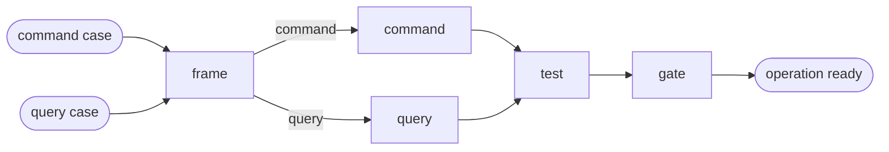

# Add CQRS Operation

## Actions

Run the flow above. Read only the next action file.

| Action  | Does                                |
| ------- | ----------------------------------- |
| frame   | confirm the operation and its shape |
| command | write the command and its handler   |
| query   | write the query and its handler     |
| test    | write the handler test              |
| gate    | run the quality gate                |

## Transversal rules

- Locate the Domain and Application source roots, their namespaces and the test roots from the project memory (`codebase-map.md`, `architecture.md`). Never assume a layout.
- Run `command` or `query` according to the frame, never both in one pass.
- Skip the frame questions when `scaffold-aggregate` already passed a confirmed frame.
- Read an existing operation of the project before writing, and match it. Never invent a structure.
- Rules of the library live in the installed `eventually*` memory files (`aidd_docs/memory/external/`). Cite them, never copy them.
- Never commit.
- If a cited file cannot be read, stop and say so.
