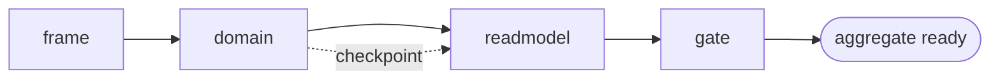

# Scaffold Aggregate

## Actions

Run the flow above. Read only the next action file.

| Action    | Does                                           |
| --------- | ---------------------------------------------- |
| frame     | collect and confirm the aggregate frame        |
| domain    | write the aggregate, its events and its test   |
| readmodel | write the view, its mapping and the projector  |
| gate      | run the quality gate                           |

## Transversal rules

- Locate the Domain and Application source roots, their namespaces and the test roots from the project memory (`codebase-map.md`, `architecture.md`). Never assume a layout.
- Pause for the user after domain, and wait for a reply before going on.
- Read an existing aggregate of the project before writing, and match it. Never invent a structure.
- Delegate each command and query to `add-cqrs-operation`. This skill never restates their shapes.
- Rules of the library live in the installed `eventually*` memory files (`aidd_docs/memory/external/`). Cite them, never copy them.
- Never commit.
- If a cited file cannot be read, stop and say so.
